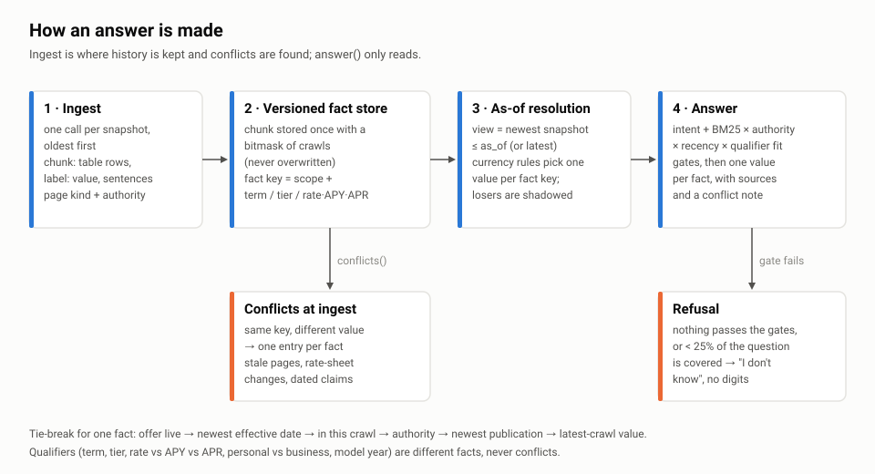
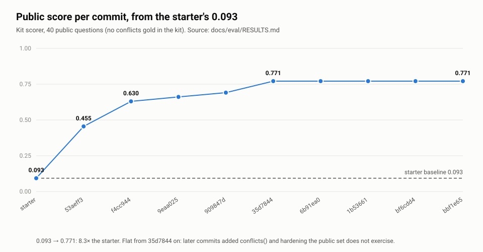
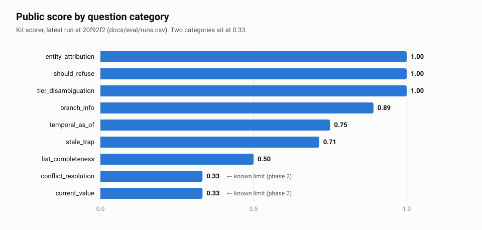
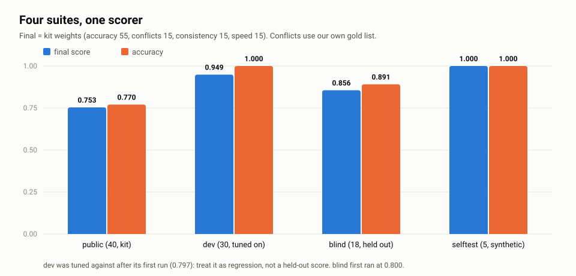
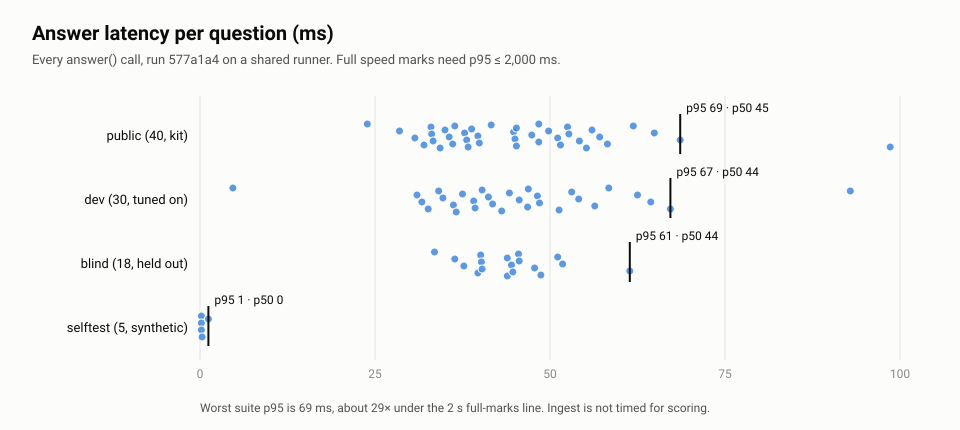

<!-- Slides are separated by a line holding only `---`. PDF: `node scripts/deck_pdf.mjs` (see docs/deck/README.md).
     Rules for this file: no snapshot page text, and no public eval question or answer text. tests/test_deck.py checks it. -->

# bank-gpt: a knowledge engine that knows what's true *now*

Knowledge Hackathon, L2 proof of work

- Solution: `submission/` on `main` at `577a1a4` (HACA-5)
- Public practice set: **0.771** with the kit's own scorer, against the starter's **0.093**
- Deterministic, standard library only, no API keys, no network calls

Backend only. No hosted demo: a public demo would serve the snapshot content, and the rules forbid redistributing it.

---

## The problem

A credit union's website, crawled five times between May and September 2026. Members ask questions; the assistant has to answer from those crawls.

- A rate changes, but an old page, PDF or calculator still shows the old number.
- A promotion ends, but its page is never taken down.
- Rate vs APY vs APR, terms, balance tiers and model years look like contradictions when they are separate facts.
- Old press releases and blog posts describe offers from years ago.

**Scoring (hidden set, same scorer):** accuracy 55%, conflicts 15%, consistency 15%, speed 15%. An answer that repeats an old value scores **zero**, even if the right value is also there, so listing every number doesn't pay. Consistency and speed are multiplied by accuracy.

---

## Approach



---

## Approach: the parts that matter

- **Keep history, never overwrite.** Each chunk is stored once with a bitmask of the crawls that saw it. `as_of` selects the newest crawl on or before the date.
- **Facts have keys.** A table row or `label: value` line becomes product scope plus its qualifier cells: term, amount tier, model-year rank, and rate vs APY vs APR column. Model-year tiers are aliased by rank, so a stale page's older tier names still line up with the rate sheet.
- **Conflicts are found at ingest, not at question time.** Rows that share a key but disagree are resolved once by the currency rules. The losers are shadowed: never quoted, never cited.
- **Answers are gated.** A rate answer needs a real rate value from a rate sheet or product page, the named product, and the term, tier and qualifier asked for, from an offer that hasn't ended. When nothing passes, the system refuses, and the refusal carries no digits.
- **Fast.** Ingest of all five crawls takes about 7 s, and answers return in tens of milliseconds.

---

## Currency rules: what "current" means

1. **Snapshot view.** "Now" is the newest crawl. A page missing from a later crawl is carried forward from its last crawl, at lower rank, because a crawl gap isn't a deletion.
2. **Newest effective date wins.** For one fact key, the row whose table says it is effective latest wins; undated copies lose to dated ones.
3. **Then source authority.** Rate sheet > product page > home page > landing page > newsroom = PDF > blog > resources > calculators > tag pages > expired offers. Calculators and blogs never answer a rate question.
4. **Expired offers never win.** An end date before the crawl date marks the chunk expired.
5. **Dated statements: the newest publication wins.** Counts and "Nth time" claims come from the most recent release.
6. **Qualifiers are different facts, never conflicts.** Term, rate/APY/APR, standard/jumbo/special, tier, personal/business, model year, purchase/refinance.
7. **When the site doesn't say, say so.** No guessing across terms or tiers.

The rules are unit-tested in `tests/test_currency_rules.py`, on synthetic pages, so no snapshot data is needed.

---

## Results: score per commit



---

## Results: by question category (public)



---

## Results: four suites, one scorer



| Suite | Final | Accuracy | Stale-trap hits | How to read it |
|---|---|---|---|---|
| public | 0.753 | 0.770 | 0 | the kit's 40 practice questions |
| dev | 0.949 | 1.000 | 0 | regression only: tuned against after a first run of 0.797 |
| blind | 0.856 | 0.891 | 0 | written before the system saw it; first run 0.800 |
| selftest | 1.000 | 1.000 | 0 | the kit's synthetic second site; was 0.178 before the generalisation fixes |

---

## Results: speed and the four pillars



Public pillars: accuracy 0.771, consistency 1.0 × accuracy, speed 1.0 × accuracy, conflicts 0.657. Conflicts are scored against our own 12-item gold list, with recall 12/12, resolution accuracy 0.92 and precision 0.375, because the kit ships no gold list.

---

## Honest limits

- **current_value: 0.33 and conflict_resolution: 0.33 on the public set (1 of 3 each).** The misses need a fact from a different paragraph than the best lexical match, synthesis across passages, or a link target rather than page text. One-passage lexical composition can't do any of these.
- **list_completeness: 0.50.** The answer composes from one or two passages, so items spread across a page get dropped.
- **Free text is not fact-checked against the tables.** Gates keep paragraphs out of rate answers, but a stale number in prose is not shadowed the way a stale table row is.
- **Our numbers are partly self-graded.** The dev set was tuned against, the conflicts gold is ours and deliberately small (so the 0.375 precision is a floor, not a measurement), and the blind set has 18 items, two of which still fail.
- **One public item can't be won without the LLM judge:** its `must_include` is empty.
- **No item is hard-coded.** The misses are left as misses.

---

## Phase 2: an LLM composer behind a flag

**What it would add.** A composer for the questions that lexical retrieval can't settle: cross-passage synthesis, complete lists, and "which of these passages answers the question". It targets the 0.33 and 0.50 categories above.

**How it would stay honest (the plan; none of this is built yet).**

- Opt-in with an environment flag. Without it, v1 runs unchanged with no key.
- It would read only the passages the gates already admitted, after shadowing, so it couldn't bring back a stale value, and its answer would have to cite one of them.
- Temperature 0, with answers cached per (question, view), so consistency stays at 1.0.
- Refusal stays deterministic: if the gates find nothing, the LLM isn't called.

**Adoption bar.** Adopt it only if it raises the public and blind scores, keeps 0 stale-trap hits, and keeps p95 within the 2 s full-marks line. It needs `ANTHROPIC_API_KEY`; v1 needs none.

---

## Reproduce

```
python harness/run_eval.py --submission submission --eval eval/public_eval.jsonl   # 0.7705
python scripts/eval_report.py                    # all suites → docs/eval/latest.md, runs.csv
python scripts/deck_measure.py                   # latencies + pillars → docs/deck/data/
python scripts/deck_figures.py                   # figures → docs/deck/figures/
python -m unittest discover -s tests             # currency rules + deck checks
```

The five kit zips go in `snapshots_zip/`, which is gitignored. The snapshot data was never committed: the repo is public, and the rules forbid redistributing the data.

Details: `NOTES.md` (approach and rules) and `docs/eval/RESULTS.md` (every run).
